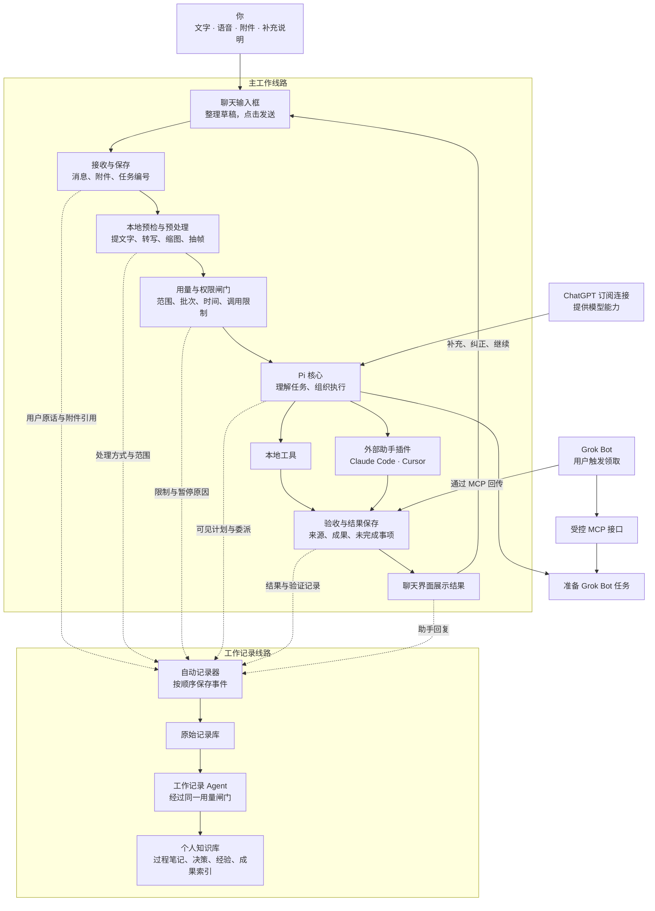
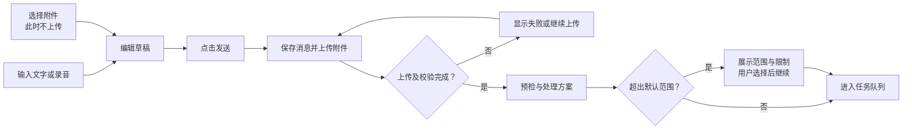
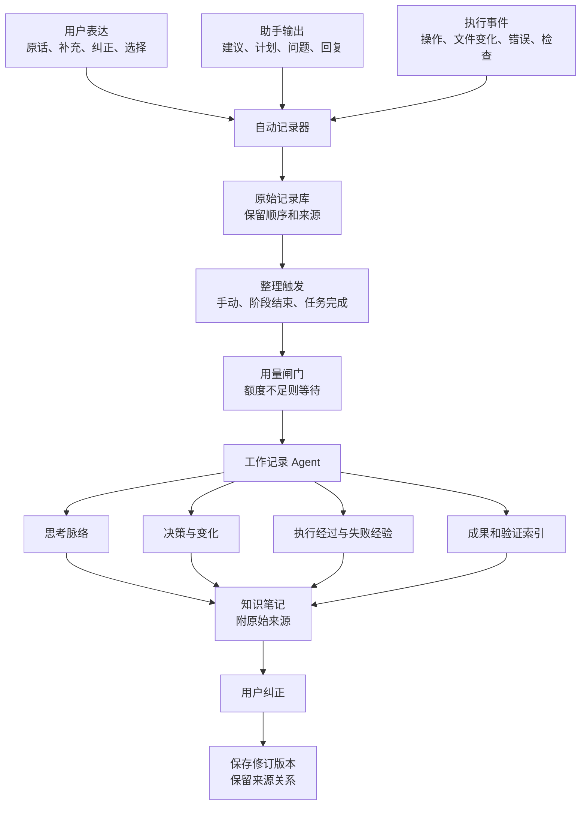

# 个人 Agent Harness 完整方案
以 Pi 为核心的模块化个人 AI 工作台与工作过程知识库

日期：2026-10-21  
版本：整合草案 v0.1  
状态：设计阶段，尚未安装、开发或验证账号接入

## 一、我要建立什么

建立一个自己的个人 AI 工作台：

- 用类似 ChatGPT 的界面提交文字、语音和附件。
- 以 Pi 为核心组织任务，其他能力通过模块接入。
- 优先使用已有的 ChatGPT、Claude、Cursor 订阅。
- 大文件先预处理，控制进入模型的材料和调用次数。
- 支持 Grok Bot 通过 MCP 参与协作。
- 贯穿全过程保存原话、工作记录、决策变化和成果。
- 用独立的“工作记录 Agent”把这些材料整理成个人知识库。

第一版按个人本地使用设计：网页和后台运行在自己的电脑上，电脑开机时处理任务。模型和部分外部助手仍可能在云端运行，因此“本地工作台”不代表所有内容都不离开电脑。

## 二、这个方案是怎样聊出来的

以下引文摘自本次对话，保留原表达；“需求理解”是 AI 的整理，不冒充我的原话。

### 1．起点：理解 Agent Harness 为什么强

**我的原话：**

> “为什么别人搭建的这个 Agent Harness 这么牛逼呢？”

> “他们是怎么做的吗？”

**需求理解：**

最初关注的是原理：模型如何通过工具、反馈和持续执行完成真实任务。

**形成的设计方向：**

系统应包含“理解任务 → 执行 → 接收结果 → 验证 → 修正”的闭环，而不只是一个聊天入口。

### 2．从了解工具，转向搭建自己的系统

**我的原话：**

> “如果我也想搭建一个自己的 Agent Harness”

> “我把DeepSeek和这个pi两个结合起来”

**需求理解：**

希望吸收现有项目的优点，并获得自己能控制、能扩展的系统。

**形成的设计方向：**

以 Pi 为核心，借鉴 DeepSeek 的模块化理念。不同模块通过统一接口连接，不要求把两套 Harness 整体叠加。

### 3．明确费用约束

**我的原话：**

> “我不想接入这个付费模型的API，而是我有GPT ，Claude，还有 Cursor的订阅会员。”

> “我不想要用计费的API。”

**需求理解：**

优先使用已经购买的订阅，避免额外的按量计费。

**形成的设计方向：**

建立“仅使用已验证订阅路径”的模式。额度不足就暂停，不自动切换付费 API。各平台的额外用量、充值和消费设置需要核对。

### 4．发现大文件和批量处理的问题

**我的原话：**

> “如果我想批量处理一些大的文件呢。”

> “就比如说我上传一个G的这个视频或者图片，来直接丢进去输入框处理，那我不是额度瞬间就没有了。”

**需求理解：**

输入应当方便，但上传不能直接触发不可控的模型消耗。

**形成的设计方向：**

把上传、预处理和模型分析分开。限制最终送入模型的文字、图片、片段和调用次数。

文件大小不能直接换算成会员额度。

### 5．明确输入体验

**我的原话：**

> “输入框的话，就是类似于现在的这个GPT的这个输入框吧，可以语音输入，然后的话，附件上传之后，我也可以再加一些评论，然后点击发送再上传。”

**当前交互解释：**

选择附件后先显示待发送卡片，允许补充文字、语音和其他附件；点击发送才实际上传。

**形成的设计方向：**

支持文字输入、语音转文字、拖入附件、移除附件和编辑草稿。语音转写完成后不自动发送。

### 6．要求保留原话与思考过程

**我的原话：**

> “这个方案是我从头到尾跟你聊出来的。”

> “我想要把我的这个原话和思考也体现在这个方案里。”

> “这个对于我后续建立自己的这个，嗯，就是知识库很重要。”

**需求理解：**

知识库不仅要保存最终答案，也要保存问题如何提出、意见如何变化、决定如何形成。

**形成的设计方向：**

原始表达与 AI 整理分开保存，设计条目关联来源消息，后续修改保留版本。

### 7．增加 Grok Bot 协作

**我的原话：**

> “我希望你加上这个 Grok Bot 的这个，这个 AI 的接入。”

**术语修正：**

最初说“NCP协议”，随后明确纠正为：

> “MCP”

**形成的设计方向：**

增加 Grok Bot MCP 协作接口，先验证领取任务、读取材料和回传结果。自动唤起能力单独验证。

### 8．要求图形化，并增加全过程记录 Agent

**我的原话：**

> “我更喜欢图形，就是流程图这样直观的呈现方式。”

> “我希望就是在这个整个流程外挂一个 Agent”

> “我想把我这个我说过的话从头到尾记录下来。”

> “就是相当于一个 Agent，记录我所有的一些工作的过程。”

**形成的设计方向：**

系统包含两条线路：

- 主工作线路：完成任务。
- 工作记录线路：保存过程，整理知识。

程序负责可靠保存，工作记录 Agent 负责理解和整理。

## 三、整体设计图



图中的外部助手和 Grok Bot 是分阶段接入能力，不代表第一版已经全部可用。

## 四、用户界面与发送流程

第一版设置两个主要视图：

| 视图 | 用途 |
|---|---|
| 聊天 | 提交任务、补充说明、查看进度和成果 |
| 工作记录 | 回看原话、操作时间线、决策变化和知识笔记 |

输入框示意：

```text
┌─────────────────────────────────────────┐
│ 对话、进度、处理方案、结果               │
│                                         │
│ 待发送附件：                            │
│ [会议录像.mp4 · 1 GB · 移除]             │
│ [补充说明.pdf · 移除]                   │
│                                         │
│ 请总结前十分钟，重点关注预算……          │
│                                         │
│ ＋附件          🎤语音          发送 ↑  │
└─────────────────────────────────────────┘
```

完整流程：



语音第一版采用“录音 → 本地转写 → 编辑 → 发送”。不做持续实时语音对话。

## 五、模块划分

| 模块 | 职责 | 设计要求 |
|---|---|---|
| 聊天界面 | 输入、附件、语音、进度与结果 | 不直接调用模型服务 |
| 上传与文件库 | 分块上传、校验、续传、去重 | 原件与预处理副本分开 |
| 本地预处理 | 文本提取、OCR、缩图、字幕、转写、抽帧 | 可以单独替换实现 |
| 任务管家 | 排队、取消、恢复、状态管理 | 模型不可用时仍能运行 |
| Pi 连接层 | 会话、工具注册、输出接收 | 隔离 Pi 的具体接口 |
| 订阅与助手插件 | ChatGPT、Claude Code、Cursor | 只启用已验证路径 |
| Grok Bot MCP 桥接 | 任务领取、材料访问、回传 | 按任务授权，不开放整个文件库 |
| 用量与权限控制 | 限制材料、次数、时长、文件范围 | 由程序执行 |
| 自动记录器 | 保存原始消息和执行事件 | 不依赖模型判断是否值得记 |
| 工作记录 Agent | 整理过程、决策与经验 | 可延后、可修订、可追溯 |
| 结果与知识存储 | 成果、笔记、来源关系与导出 | 支持版本和删除 |

统一任务单包含：目标、来源消息、文件编号、允许范围、完成标准和执行限制。

统一结果单包含：结论、成果引用、处理范围、检查证据、错误、未完成事项和外部会话编号。

## 六、订阅与助手接入

### ChatGPT：第一版主连接

优先验证 Pi 的“Sign in with ChatGPT”路径，为 Pi 提供模型能力。Pi 发布说明与 OpenAI 文档提供了相关支持；实际资格、可用模型和额度仍以账号授权及实测为准。

参考：[Pi 发布说明](https://github.com/earendil-works/pi/releases)、[OpenAI 订阅接入说明](https://developers.openai.com/cookbook/articles/sign-in-with-chatgpt)。

### Claude Code、Cursor：后续执行插件

通过官方工具中的用户登录接收完整任务，保留各自的工具执行能力。第一版只预留统一接口，不要求它们与 Pi 同时参与每个任务。

参考：[Claude Code 程序化执行](https://code.claude.com/docs/en/headless)、[Cursor 后台执行](https://cursor.com/docs/cli/headless)。

### Grok Bot：MCP 协作

已查到的接入方向是：Grok Bot 作为客户端调用我们提供的 MCP 工具。这不能直接证明 Pi 可以自动启动 Grok Bot。

拟实现工具：

| 工具 | 功能 |
|---|---|
| 查看待办 | 列出分配给 Grok Bot 的任务摘要 |
| 领取任务 | 获取任务，防止重复领取 |
| 读取材料 | 按授权读取有限片段或预览 |
| 更新进度 | 报告执行状态和阻碍 |
| 提交结果 | 回传结果与成果引用 |

第一版采用用户在 Grok Bot 中触发领取的方式，自动唤起另行验证。

Grok Bot 在云端运行，远程 MCP 需要可达的 HTTPS 地址及身份验证。本机 localhost 不能直接供其访问。该桥接作为可选接入，不要求把整个本地工作台公开到互联网。

参考：[自定义 MCP 接入说明](https://forum.cursor.com/t/grokbot-custom-connectors/169965/5)、[Grok Bot 官方说明](https://cursor.com/docs/grok-bot)。

## 七、大文件预处理与额度控制

### 文件处理策略

| 类型 | 默认处理方式 |
|---|---|
| 文本、PDF | 提取文字，按页或章节切分；扫描件按需 OCR |
| 图片 | 先缩略图，再按需要读取局部高清内容 |
| 视频 | 先检查时长、字幕与音轨，再决定转写、抽帧或分段 |
| 批量文件 | 去重、排队、抽样试跑、分批继续 |

结果必须说明实际覆盖范围。例如“根据字幕总结”不能表述成“完整检查了全部视频画面”。

### 程序执行的限制

- 限制单次发送的文字、图片和视频片段数量。
- 限制任务时长、自动重试和外部委派次数。
- 默认一次执行一个 AI 任务。
- 批量任务先用最多三个样本试跑，再选择继续范围。
- 额度不足时保存进度并暂停。
- 不自动切换按量计费 API。
- 记录可获取的实际用量；未知的剩余额度标为未知。

以上批次和并发值是初始建议，通过真实任务调整。

所有 Pi 模型请求及工作记录 Agent 的整理请求都经过闸门。外部助手能控制的是委派、材料和运行边界，不能据此承诺能精确限制其内部每次推理。

不配置 API Key 也不能单独保证无额外费用；平台额外用量、自动充值及第三方工具收费必须核对。

## 八、外挂的工作记录 Agent

### 设计目标

让知识库回答两类问题：

- 最后得到了什么？
- 当时为什么这样想、如何推进、在哪里改变了决定？

### 内部流程图



### 记录范围

第一版完整记录工作台内已发送消息，以及由它发起且能获取的执行事件。

- 草稿保存用于恢复，不默认永久记录每次按键。
- 语音转写初稿与发送版本分开标注；录音长期保存可配置。
- 附件记录原件引用、补充说明及实际处理片段。
- 外部助手不可见的内部过程标明不可见。
- 不记录模型隐藏推理；记录可见计划、输出、操作和证据。
- 其他软件中的工作需要额外连接，第一版不承诺自动覆盖。
- 密钥与登录凭证不进入记录；删除操作同步处理派生笔记。

### 知识笔记的固定结构

1. 任务从哪里开始。
2. 用户原话与来源。
3. AI 如何理解需求。
4. 提出了哪些方案。
5. 哪些决定明确采纳，哪些仍待确认。
6. 执行了什么，失败和修正发生在哪里。
7. 最终成果及验证情况。
8. 后续未解决的问题。

原始表达、AI 解释和用户确认必须有不同标记。不能把 AI 的推荐自动记为用户已采纳。

### 额度安排

原始记录即时保存，不依赖模型。

AI 整理默认批量进行，优先级低于主任务。额度不足时继续保存原始记录，整理排队等待。

记录异常应在界面提示；不能静默丢失，也不能把不完整记录标成完整。

## 九、存储与技术建议

| 部分 | 建议实现 |
|---|---|
| 网页 | React + TypeScript |
| 后台 | Node.js + TypeScript |
| Agent 核心 | Pi SDK，通过独立连接层使用 |
| 状态与索引 | SQLite |
| 原件、片段、成果 | 本地文件目录 |
| 视频处理 | FFmpeg / ffprobe |
| 语音、OCR、文档处理 | 独立本地处理进程 |
| 知识导出 | Markdown、结构化记录、附件清单 |

消息、任务、操作、文件、笔记之间通过稳定编号关联。没有准确时间时只记录顺序，不补造时间。

本地保存不等于备份。需提供导出与恢复路径，并用独立副本验证恢复。

## 十、第一版具体做哪些

### 第一阶段：先打通可靠的最小闭环

| 内容 | 验收条件 |
|---|---|
| 原始消息和事件记录 | 用户消息、助手回复、操作能按顺序关联 |
| Pi 与订阅验证 | 本账号完成小任务，核对认证和计费路径 |
| 基本聊天界面 | 能发送、查看进度、取消并保存结果 |
| 任务状态 | 能区分排队、执行、暂停、失败和完成 |

记录底座从第一天开始建设，避免后补时丢失过程。

### 第二阶段：完整输入和大文件处理

| 内容 | 验收条件 |
|---|---|
| 附件草稿 | 选择后可补充说明，发送前无上传请求 |
| 分块与续传 | 1 GB 测试文件能上传、校验，中断后续传 |
| 本地预处理 | 模型只获取允许范围内的材料 |
| 语音输入 | 中文转写可编辑，确认后才发送 |
| 用量闸门 | 达到限制确实暂停，不继续调用 |

### 第三阶段：工作过程知识库

| 内容 | 验收条件 |
|---|---|
| 工作时间线 | 能回看原话、操作、错误与成果 |
| “整理这次工作”按钮 | 生成带来源的过程笔记 |
| 用户修订 | 可纠正解释，保留版本和原文 |
| 导出与恢复 | 可导出记录和附件，并验证恢复 |
| 中断恢复 | 重启后能识别中断任务，不盲目重复操作 |

### 第四阶段：Grok Bot 最小协作验证

完成一个独立测试：

**领取一个任务 → 读取一份受限材料 → 回传一次结果 → 工作台显示并记录。**

验证云端连通、身份验证、账号权益、材料限制与回传。任何一项未通过，就标记待验证，不影响本地核心工作台交付。

## 十一、第一版暂不做什么

- 多个助手同时修改同一个项目。
- Pi 自动唤起 Grok Bot 的未验证能力。
- 持续实时语音对话。
- 整台电脑所有软件的自动记录。
- 电脑关机后的云端收件与长期调度。
- 无人值守、无限重试的长任务。
- 精确到会员百分比的虚假消耗预测。

Claude Code、Cursor 完整自动委派，以及更复杂的定时与跨设备协作，在核心流程稳定后接入。

## 十二、如何判断第一版成功

一个完整验收场景：

我选择一个大视频，用语音输入“只总结前十分钟，重点看预算”，修改文字后点击发送。

系统完成上传和预检，展示分析范围，在限制内处理并返回结果；我继续提出修改，它保存新的要求和结果。

最后点击“整理这次工作”，得到一份能追溯原话、处理范围、修改过程和最终成果的知识笔记。

第一版既要帮我把事情做完，也要让我以后能看懂：这件事是怎样从我的一句话，逐步变成最终结果的。